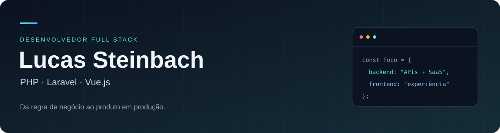

  

  
  
  

## Olá, sou o Lucas

Desenvolvedor Full Stack com **6 anos de experiência**, com foco em **PHP, Laravel, Vue.js e JavaScript**. Desenvolvo sistemas SaaS, aplicações corporativas e APIs REST, atuando do backend e frontend à infraestrutura e ao deploy.

Gosto de transformar regras de negócio em produtos úteis: automatizar processos, integrar serviços e construir aplicações que resolvam problemas reais.

- **Backend:** APIs, autenticação, permissões, filas, tarefas agendadas e webhooks.
- **Integrações:** pagamentos, assinaturas, WhatsApp, calendários e serviços de IA.
- **Produtos:** gestão clínica, comunidades, marketplaces e aplicativos mobile.
- **Objetivo profissional:** oportunidades em desenvolvimento Full Stack ou Backend PHP/Laravel.

## Tecnologias

| Área | Ferramentas com que trabalho |
| --- | --- |
| Backend | PHP · Laravel · Node.js · APIs REST · Sanctum |
| Frontend | Vue.js · JavaScript · TypeScript · React · Angular · Tailwind CSS |
| Mobile e desktop | React Native · Expo · Python · PySide6 |
| Dados e infraestrutura | MySQL · PostgreSQL · SQLite · Docker · Git · Vercel · Easypanel |
| Qualidade e integrações | PHPUnit · pytest · Vitest · Webhooks · OpenAI · Gemini · Groq |

## Projetos em destaque

Uma seleção de produtos e projetos pessoais. Alguns repositórios são privados; nesses casos, os links levam à apresentação ou à aplicação.

| Projeto | O que desenvolvi | Conheça |
| --- | --- | --- |
| **PsicoProntuários** | SaaS para psicólogos com prontuários, agenda, financeiro, automações e recursos de IA. | [Site e demonstração](https://psicoprontuarios.com.br/) |
| **MotoConexão** | Aplicativo com React Native, Expo e Laravel: rede social para motociclistas, registro de rotas e GPS em segundo plano. | [Google Play](https://play.google.com/store/apps/details?id=com.lucassteinbach.MotoConexao) · [Backend](https://github.com/lucaswalmor/motoconexao_backend) |
| **Vincly** | Projeto pessoal de SaaS para gestão e monetização de comunidades, com checkout, assinaturas e automações. | [Apresentação](https://vincly-automation.vercel.app/) · [Sistema](https://app-vincly.vercel.app/) |
| **Nexial Hub Pagamentos** | Projeto pessoal de API de integração com gateways, com Asaas, autenticação por API Keys e documentação interativa. | [Aplicação](https://lucas-api-pagamento.irkqjy.easypanel.host/) · [Documentação](https://lucas-api-pagamento.irkqjy.easypanel.host/docs) |
| **PetGre** | Plataforma para o mercado pet com catálogo, pedidos, painel do lojista e integrações com WhatsApp. | [Backend](https://github.com/lucaswalmor/petgre-backend) · [Frontend](https://github.com/lucaswalmor/petgre-cliente) |
| **DevLingo** | Aplicativo desktop em Python para transcrição e tradução de conversas técnicas e prática de entrevistas em inglês. | [Código e documentação](https://github.com/lucaswalmor/devlingo) |

## Como trabalho

Priorizo responsabilidades claras, regras de negócio bem definidas, documentação e testes nos fluxos importantes. Uso IA como apoio ao desenvolvimento, com revisão das alterações e validação do comportamento da aplicação.

## Vamos conversar?

Estou em **Uberlândia/MG**, com disponibilidade para trabalho remoto, híbrido ou presencial e possibilidade de mudança.

**[Fale comigo no LinkedIn](https://www.linkedin.com/in/lucas-steinbach-1a602915a/)** · **[Veja meu portfólio](https://lksoftware.vercel.app/)**

<strong>English overview</strong>

Full Stack Developer with 6 years of experience, focused on PHP, Laravel, Vue.js and JavaScript. I build SaaS products, REST APIs, business applications and integrations, from backend and frontend development to deployment.

My projects include healthcare software, a motorcycle community app, payment integrations and desktop tools powered by AI. I work with authentication, queues, scheduled jobs, webhooks and automated tests.

Based in Uberlândia, Brazil. Open to Full Stack and PHP/Laravel Backend opportunities.

[LinkedIn](https://www.linkedin.com/in/lucas-steinbach-1a602915a/) · [Portfolio](https://lksoftware.vercel.app/)

